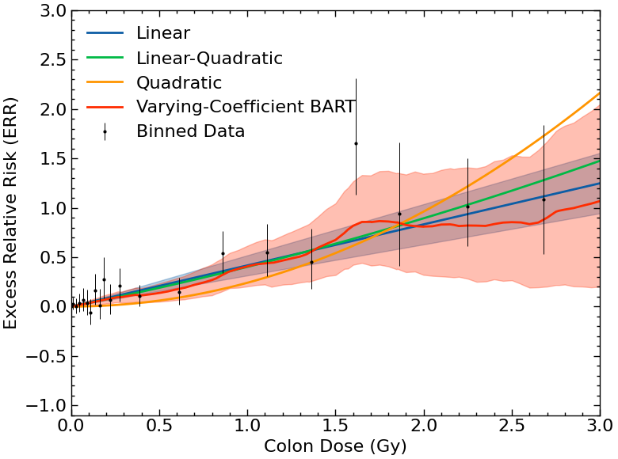
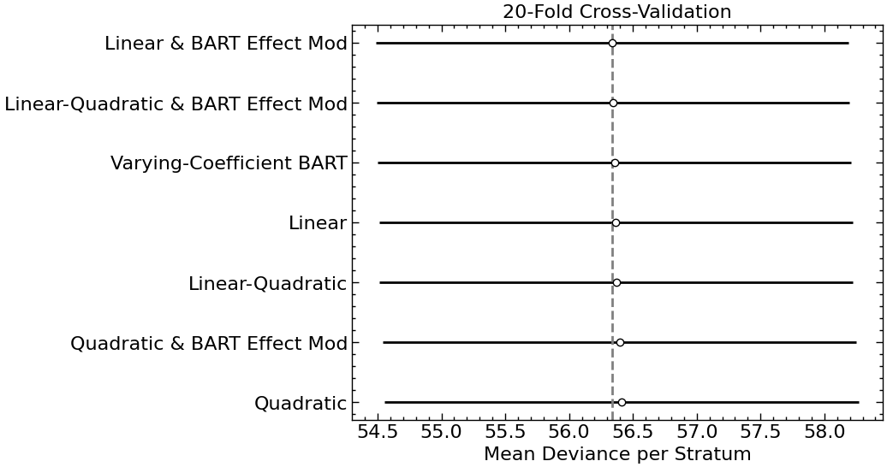
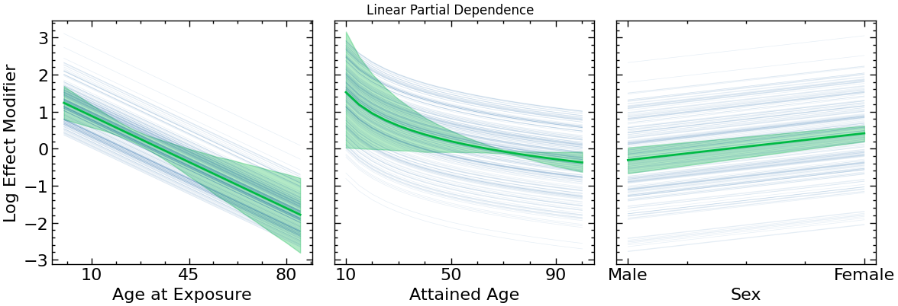
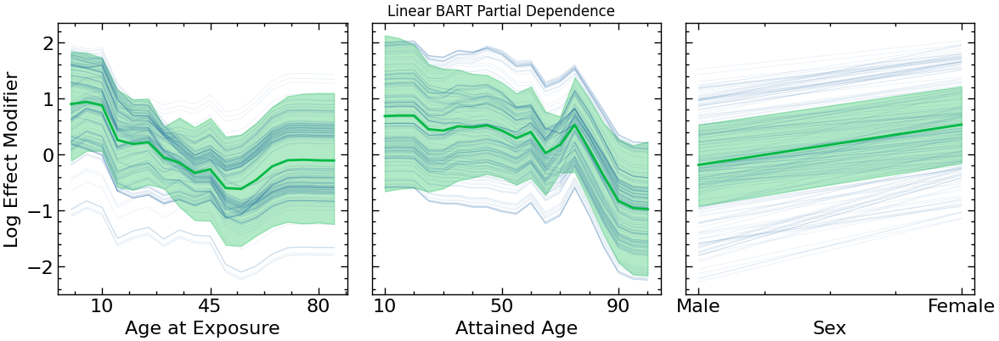

# Bayesian Nonparametric Modeling of Solid Cancer Mortality Among Atomic Bomb Survivors

Using data from the Life Span Study (1950--2003) of survivors of the atomic bombings of Hiroshima and Nagasaki, we revisit the linear no-threshold model of the excess relative risk of solid cancer death from radiation exposure using a range of parametric and nonparametric Bayesian Markov chain Monte Carlo techniques. Specifically, we evaluate flexible dose-response relationships and flexible effect-modifier relationships using Bayesian Additive Regression Trees and compare our results with the functional forms used by Ozasa et al. in the Life Span Study's Report 14. A linear dose response with nonparametric effect modifiers is the best-performing model based on out-of-sample predictive performance in a 20-fold cross-validation scheme and as measured by the PSIS-LOO metric, though it is only a small improvement with high uncertainty. These results are consistent with the use of a linear dose response for radiation protection standards and demonstrate the possibility of better predicting how individual-level characteristics like age at exposure and attained age affect health outcomes.










Our varying-coefficient BART model describes the excess relative risk per Gy as a function $g$ of dose, sex, age at exposure, and attained age:
$$
\text{ERR} = g(d, s, e, a) d, \qquad g = \text{BART}.
$$

We also combine parametric dose-response models, $f(d)$, with a BART effect modifier, modeling the log effect modifier with BART:
$$
    \text{ERR} = f(d) \, \frac{\exp\bigl(h(s, e, a)\bigr)}{\varepsilon_{\text{ref}}}, \qquad h = \text{BART}
$$
where $\varepsilon_{\text{ref}} = \tfrac{1}{2}\bigl[\exp h(-1, 30, 70) + \exp h(1, 30, 70)\bigr]$ is the sex-averaged BART effect modifier for a person exposed at age 30 at attained age 70. 

# Reproducing Results

Run `uv sync` to install the environment (Python 3.13).

The results are saved in `results/`, so the plots can be quickly regenerated locally. The dose-response and partial dependence plots are in `src/plots.ipynb`, and the cross-validation and PSIS-LOO comparison plots are in `src/model_comparison.ipynb`. The likelihood derivation is in `src/calculus.ipynb`.

Rerunning the models is very computationally intensive. For those with access to a SLURM cluster, run `./run.sh && ./run_psis_loo.sh`, `./run_cross_validation_parallel.sh`, and `./run_err_gy.sh` to start the jobs. The scripts use our cluster's `mit_normal` partition, so change `-p mit_normal` in `run_slurm.sh`, `run_cv_slurm.sh`, `run_cv_parallel_slurm.sh`, `run_psis_loo.sh`, and `run_err_gy.sh` to a partition on yours.

Results are saved to
- `results/idata/<model>_idata.nc`: posterior samples
- `results/figures/<model>_figures.nc`: data for the figures in `plots.ipynb`
- `results/psis_loo/<model>_loo.json`: PSIS-LOO
- `results/cross_validation/<model>_cv_results.json`: cross-validation
- `results/err_gy/`: ERR/Gy for dose ranges 0 to c, as in Ozasa et al. (2012), Fig. 5

# Cite
If you refer to this work, please cite as 
```
@article{decker_bayesian_2026,
    title={Bayesian Nonparametric Modeling of Solid Cancer Mortality Among Atomic Bomb Survivors},
    author={Decker, A.M. and Kemp, R.S.},
    year={2026},
}
```

# Acknowledgements
This report makes use of data obtained from the Radiation Effects Research Foundation (RERF), Hiroshima and Nagasaki, Japan. RERF is a private, non-profit foundation funded by the Japanese Ministry of Health, Labour and Welfare and the U.S. Department of Energy, the latter through the National Academy of Sciences. The conclusions in this report are those of the authors and do not necessarily reflect the scientific judgment of RERF or its funding agencies.

# License
MIT, see [LICENSE](LICENSE).